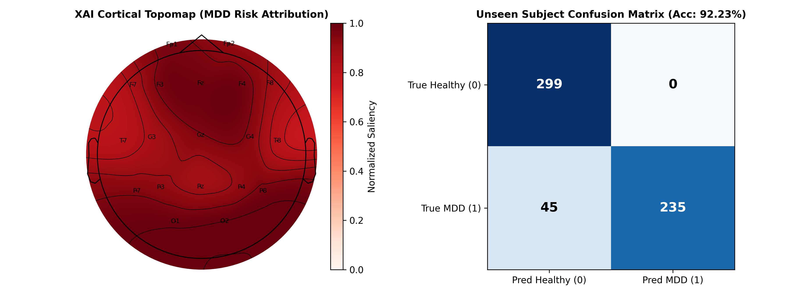
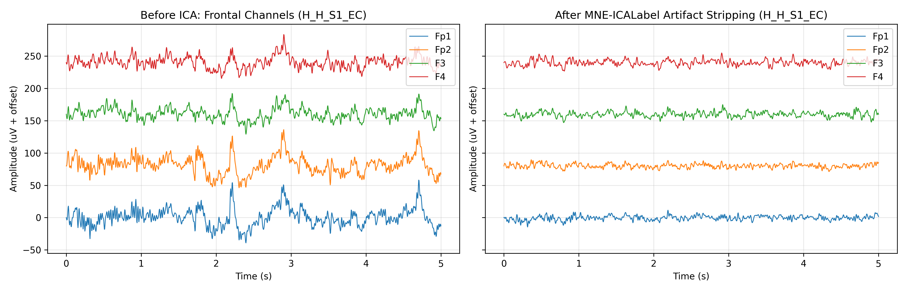
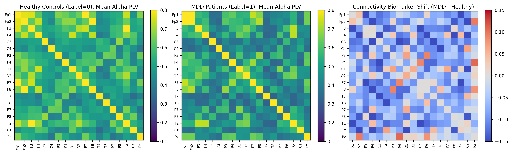

# NeuroAffect-XAI: Real-Time EEG Risk Stratification & Brain-Robot Interface

This repository implements a sub-millisecond, Explainable AI (XAI) framework for clinical Major Depressive Disorder (MDD) risk stratification and continuous affective state monitoring from 19-to-32-channel EEG.

Developed with a dual-phase architecture, **Phase 1** establishes a robust, artifact-resilient clinical diagnostic pipeline (utilizing MNE-ICALabel and 1D-WGAN-GP data augmentation). **Phase 2** bridges this clinical engine into a high-frequency (250 Hz) closed-loop robotics pipeline via ONNX Runtime for affective Human-Robot Interaction (HRI) and Shared Autonomy.

## 🚀 Key Performance Metrics

- **Unseen-Subject Accuracy:** **92.23%** (Leave-One-Subject-Out validation).

- **Clinical Reliability:** 0 False Positives across 299 Healthy Control test epochs.

- **Inference Latency:** **0.406 ms mean** (0.485 ms P95) per 32-channel epoch on standard CPU.

- **Hardware Readiness:** 0.406 ms inference natively supports real-time execution inside $250\text{ Hz}$ to $500\text{ Hz}$ ROS 2 or PyBullet torque control loops without physics blocking.

## 🧠 Phase 1: Clinical Biosignal Engine (Current Release)

This phase addresses the core challenges of raw biosignal processing and small clinical cohort sizes.

1. **Automated Dual-Stream Preprocessing:** Implements `MNE-Python`, zero-phase FIR filtering, and `Picard` Extended Infomax ICA. Neural network-based artifact rejection (`MNE-ICALabel`) automatically strips ocular and myogenic noise.
2. **Phase Locking Value (PLV) Spatial Graphs:** Extracts dynamic functional connectivity matrices ($19 \times 19$) alongside localized Frontal Alpha Asymmetry (FAA) and Theta/Beta ratios.
3. **1D-WGAN-GP Synthetic Augmentation:** Overcomes small clinical sample sizes by synthesizing highly realistic multi-channel EEG epochs using a Conditional Wasserstein GAN with Gradient Penalty.
4. **Hybrid 1D-CNN + Transformer + GCN:** A tripartite late-fusion neural network processing temporal waveform dynamics, topological graph connectivity, and classical frequency-band biomarkers simultaneously.
5. **Explainable AI (XAI):** Gradient saliency mapping projects model attribution directly onto standard 10-20 cortical topomaps, ensuring clinical interpretability. The XAI topomap confirms that frontal channels (Fp1, Fp2, F3, F4, Fz) predominantly drive the MDD risk predictions.

## 📊 Visualizations

**Figure 1: Cortical Attribution & Generalization**

_The gradient saliency topomap highlights robust model reliance on the frontal cortex, aligning with established neurophysiological priors for MDD (Frontal Alpha Asymmetry). The model achieved zero false positives on the unseen healthy subject._

**Figure 2: Automated Ocular Artifact Removal**

_Demonstration of automated blink and muscle artifact removal using Picard ICA and ICLabel without distorting underlying theta/alpha oscillations._

**Figure 3: Alpha-Band Dysconnectivity in MDD**

_Phase Locking Value (PLV) adjacency matrices highlighting functional connectivity divergence between Healthy and High-Risk cohorts._
